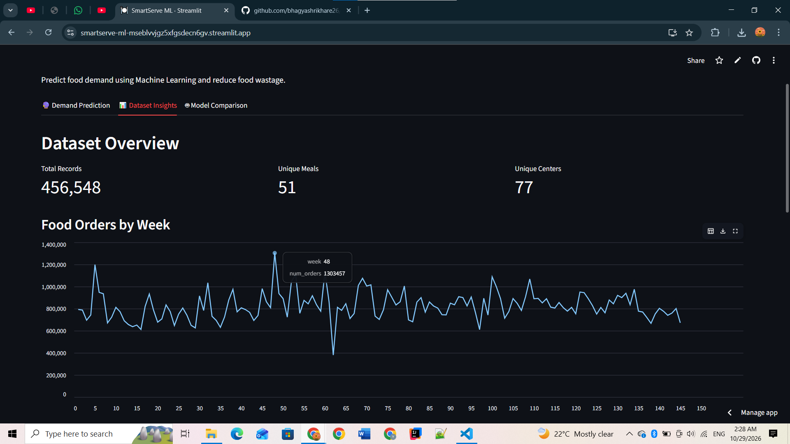
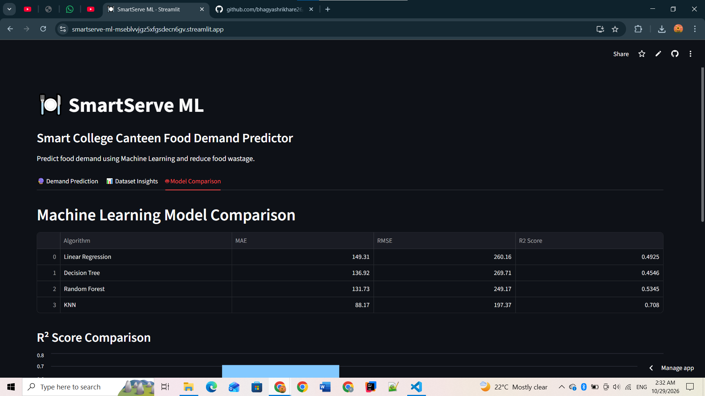

# 🍽️ SmartServe ML
### Smart College Canteen Food Demand Predictor

[](https://smartserve-ml-mseblvvjgz5xfgsdecn6gv.streamlit.app)
[](https://www.python.org/)

**SmartServe ML** is a machine learning mini-project that predicts food order demand using historical food-demand data. It helps explore how demand forecasting could support better canteen planning and reduce avoidable food waste.

🔗 **[Try the Live Application](https://smartserve-ml-mseblvvjgz5xfgsdecn6gv.streamlit.app)**  
💻 **[GitHub Repository](https://github.com/bhagyashrikhare26/SmartServe-ML)**

## 🎯 Problem Statement

Canteens need to estimate how many meals customers will order. Underestimating demand can lead to shortages, while overestimating can result in unsold food. SmartServe ML investigates demand forecasting using historical order, price, and promotion information.

## ✨ Features

- **Demand Prediction:** Enter week, canteen/center ID, meal ID, selling price, base price, promotion email status, and homepage-featured status to generate a predicted order count.
- **Dataset Insights:** Explore dataset previews and visualizations in the interactive dashboard.
- **Model Comparison:** Compare four regression algorithms and their evaluation results.
- **Interactive Web UI:** Use the Streamlit dashboard through a browser.
- **Cloud Deployment:** Access the project through Streamlit Community Cloud.

## 🛠️ Technologies

| Area | Tools / Libraries |
| --- | --- |
| Programming | Python |
| Machine Learning | scikit-learn |
| Data handling | pandas, NumPy |
| Web dashboard | Streamlit |
| Version control | Git, GitHub |
| Deployment | Streamlit Community Cloud |

## 📊 Dataset

The project uses a historical food-demand dataset with **456,548 rows and 9 columns**:

`id`, `week`, `center_id`, `meal_id`, `checkout_price`, `base_price`, `emailer_for_promotion`, `homepage_featured`, `num_orders`.

**Prediction target:** `num_orders` (number of orders).

> Note: This is a historical food-demand dataset used for a college canteen demand-prediction use case; it is not claimed to be data collected from an actual college canteen.

## 🧠 Machine Learning Algorithms

Four regression models were evaluated:

1. Linear Regression
2. Decision Tree Regressor
3. Random Forest Regressor
4. K-Nearest Neighbors (KNN) Regressor

### Model Performance

| Algorithm | MAE ↓ | RMSE ↓ | R² Score ↑ |
| --- | ---: | ---: | ---: |
| Linear Regression | 149.31 | 260.16 | 0.4925 |
| Decision Tree | 136.92 | 269.71 | 0.4546 |
| Random Forest | 131.73 | 249.17 | 0.5345 |
| **KNN Regressor** | **88.17** | **197.37** | **0.7080** |

**Best tested model: KNN Regressor**, with the lowest MAE and RMSE and the highest R² among these runs.

*MAE and RMSE measure prediction error (lower is better). R² measures goodness of fit (higher is better).* These are project experiment results, not guaranteed performance on new data.

### Demand Prediction


### Dataset Insights


### Model Comparison


## ⚙️ Run Locally

**Prerequisites:** Python and Git installed.

```bash
git clone https://github.com/bhagyashrikhare26/SmartServe-ML.git
cd SmartServe-ML
python -m venv .venv
```

**Windows Command Prompt:**

```bat
.venv\Scripts\python.exe -m pip install -r requirements.txt
.venv\Scripts\python.exe -m streamlit run app.py
```

Then open the local URL displayed by Streamlit (usually `http://localhost:8501`). The project requires its dataset and model artifacts to be available at the paths expected by `app.py`.

## 🔄 Project Workflow

**Historical dataset → Data preprocessing → Model training → Model evaluation → Select best tested model → Streamlit dashboard → Demand prediction**

## 🚀 Future Scope

- Integrate real college canteen sales data for institution-specific forecasts.
- Add calendar, holiday, and event-related predictors.
- Provide inventory planning recommendations based on forecasted demand.
- Monitor model accuracy and retrain with new orders.

## 👩‍💻 Developed By

**Bhagyashri Vinod Khare**  
Machine Learning Mini Project

---

*SmartServe ML — Predict demand, plan smarter, reduce potential food waste.*
